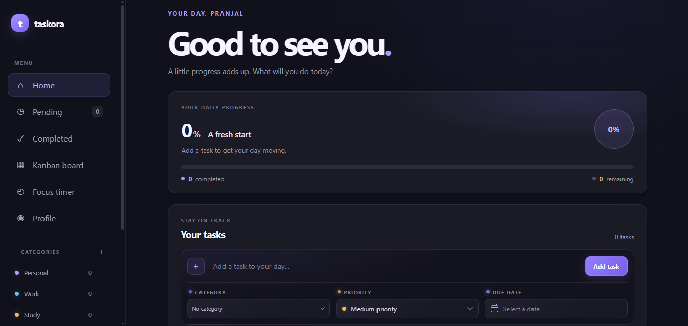
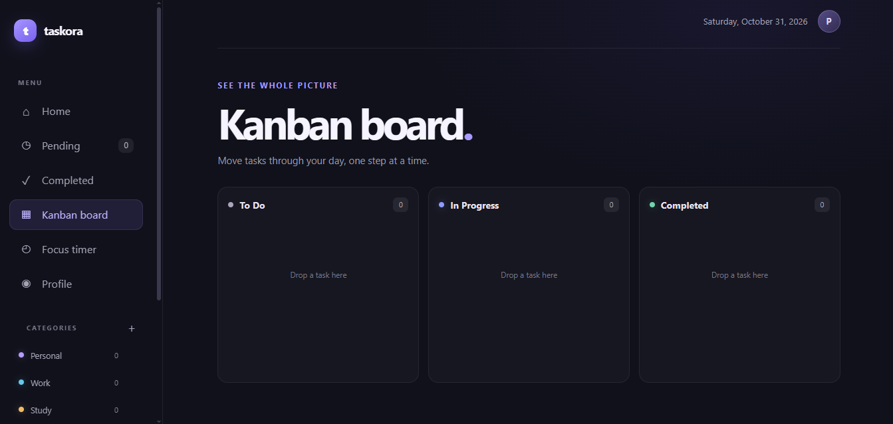
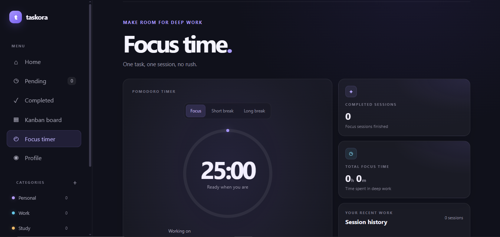

# Taskora - Smart Task Management App

Taskora is a responsive task management web application designed to help users organize their daily tasks, manage priorities, track progress, and stay focused.

It provides a clean interface with useful productivity features to make everyday task management easier.

## 🌐 Live Demo

[](https://pranjalmaurya563.github.io/Taskora/)

## ✨ Features

- **Task Management:** Add, edit, delete, and manage tasks.
- **Category Management:** Organize tasks into different categories.
- **Task Filtering:** Filter tasks based on their status and categories.
- **Kanban Board:** Manage tasks visually across different workflow stages.
- **Focus Timer:** Stay productive with a built-in focus timer.
- **Data Persistence:** Save task data using browser storage.
- **Responsive Design:** Works across desktop, tablet, and mobile screens.
- **User-Friendly Interface:** Clean and simple design for better usability.

## 🛠️ Technologies Used

- HTML5 - Structure of the application
- CSS3 - Styling, layouts, animations, and responsiveness
- JavaScript (Vanilla JS) - Application logic and interactivity
- Local Storage - Persistent storage of task data

## 📂 Project Structure

```text
Taskora/
│
├── index.html
├── style.css
├── app.js
└── README.md
```

## 🚀 Getting Started

Follow these steps to run Taskora locally.

1. Clone the repository:

   ```bash
   git clone https://github.com/pranjalmaurya563/Taskora.git
   ```

2. Open the project folder:

   ```bash
   cd Taskora
   ```

3. Open `index.html` in your browser.

You can also use the Live Server extension in VS Code for a better development experience.

## 📸 Screenshots

### Home Screen


### Kanban Board


### Focus Timer


## 🎯 Project Purpose

The main goal of Taskora is to provide a simple and practical productivity tool where users can organize their work, track task completion, and manage their time effectively.

## 🔮 Future Improvements

- User authentication
- Cloud-based data synchronization
- Notifications and reminders
- Advanced productivity analytics
- Cross-device task synchronization

## 👨‍💻 Author

**Pranjal Maurya**

- GitHub: [GitHub Profile](https://github.com/pranjalmaurya563)
- LinkedIn: [LinkedIn Profile](https://www.linkedin.com/pranjalmaurya563)

---

⭐ If you find this project useful, consider giving it a star!
